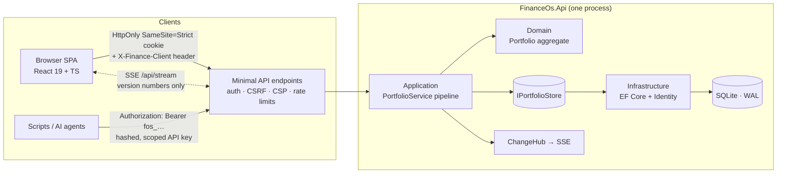
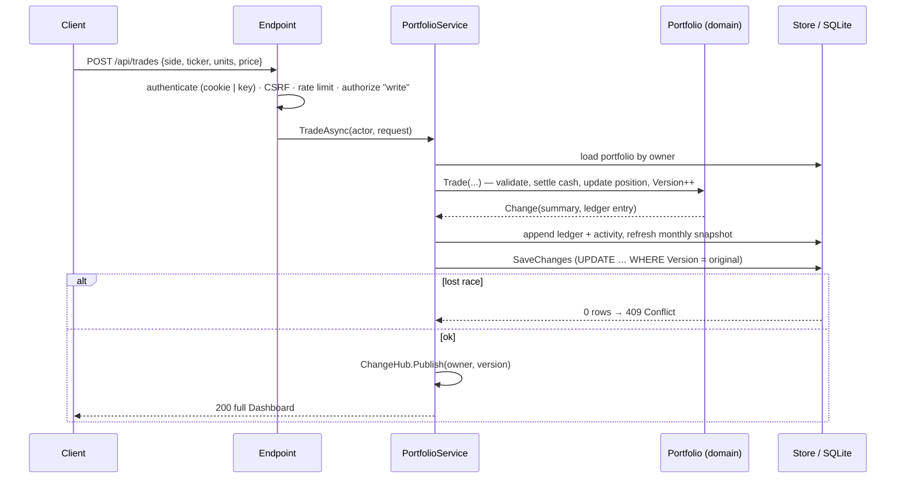

# Architecture

Finance OS v2 is one deployable: an ASP.NET Core 10 API that also serves the React SPA. Browsers, scripts and AI agents all talk to the same origin and the same API.



## Why this stack (and what changed from v1)

| Concern | v1 (Node/Fastify) | v2 | Why |
|---|---|---|---|
| Money arithmetic | JavaScript floats (`0.1 + 0.2 ≠ 0.3`) | C# `decimal`, explicit rounding (kobo/cents, 8 dp units) | A finance ledger must be exact |
| Atomicity | Several statements per trade, no transaction | One aggregate + one `SaveChanges` per command | A half-applied trade can't exist |
| Concurrency | Last write wins | Optimistic concurrency token on the portfolio → 409 | Two simultaneous buys can't both pass the same balance check |
| Reads | Unauthenticated (`GET /api/state` open to anyone) | Deny-by-default; every query scoped by owner | Your balances were public on the network |
| Writes | One shared `API_TOKEN`; open when unset; spoofable `x-actor` header | Identity cookie for humans; per-agent hashed API keys with read-only scope | Least privilege, real audit trail, revocable |
| Validation | Almost none (`+req.body.units`) | Domain invariants + allow-listed enums + unknown-field rejection | OWASP A03 / API6 |
| Frontend | 2,000 lines of string-built HTML (`innerHTML`) | React + TypeScript (strict), typed API client | Type safety; no HTML injection surface |

.NET was chosen over keeping Node for four reasons: native `decimal`, a battle-tested identity system (PBKDF2, lockout, security stamps), first-party SSE in .NET 10, and the owner's primary stack.

## Layers

| Project | Responsibility | Depends on |
|---|---|---|
| `FinanceOs.Domain` | `Portfolio` aggregate (balances, holdings, budget, research), every money rule and limit (`Rules`), append-only records (ledger, FX quotes, activity, notes, snapshots) | nothing |
| `FinanceOs.Application` | `PortfolioService` command pipeline, wire contracts, allow-list parsing, dashboard read model, sample data, v1 importer | Domain |
| `FinanceOs.Infrastructure` | EF Core `FinanceDbContext` + Identity, `PortfolioStore`, `ApiKeyService`, `ChangeHub` (SSE fan-out) | Application |
| `FinanceOs.Api` | Host, endpoints, auth schemes and policies, security middleware, static SPA | Infrastructure |
| `FinanceOs.Tests` | Domain money rules + HTTP-level security/behaviour tests (36) | Api |

## The command pipeline

Every write goes through the same path in `PortfolioService`:



Because every mutation returns the full dashboard, the client never computes balances itself. There is exactly one implementation of the money rules.

## Data model

- **Aggregate** (loaded whole, small): `Portfolios`, `Holdings`, `BudgetLines`, `Watchlist`.
- **Append-only history** (written alongside, read with limits): `Ledger`, `Activity`, `Notes`, `FxQuotes`, `NetWorthSnapshots` (one row per month, overwritten within the month).
- **Security**: `AspNet*` Identity tables, `ApiKeys` (SHA-256 hash and prefix only).

## Real-time sync

`GET /api/stream` is a Server-Sent Events stream:

- It pushes only the new version number (`event: change`), plus a 25 s heartbeat. Clients refetch through the normal authenticated API.
- No data travels over the stream, so it can't leak anything the API wouldn't.
- Each subscriber has a bounded, drop-oldest channel, with at most 8 streams per user.

## Frontend

```
web/src
├── api/          client.ts (fetch + CSRF header + ProblemDetails) · types.ts (mirrors Contracts.cs)
├── state/        usePortfolio (server-authoritative + SSE) · actions (dialog bus, form errors) · prefs (theme, privacy, routing, hotkeys)
├── features/     Overview · Investments · Cash · Budget · Research · Journal · Settings · dialogs · CommandPalette · Workspace · AuthScreen
├── ui/           Icon/BrandMark · Dialog/FormDialog (native <dialog>) · Select (glass listbox) · charts (Area, Donut, Sparkline, Range) · Toasts · Bits
└── styles/       tokens (light-dark()) · base · app
```

## Upgrade path

- **Postgres:** swap `UseSqlite` for `UseNpgsql` and regenerate migrations.
- **Market data:** add an `IPriceFeed` in Infrastructure plus a `BackgroundService` that calls `UpdatePrices`.
- **Passkeys:** ASP.NET Identity in .NET 10 ships WebAuthn passkey support (the `AspNetUserPasskeys` table already exists).
