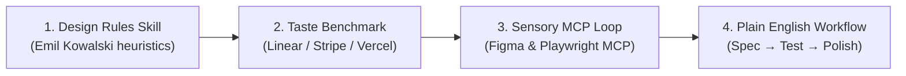

# Investment Frameworks & Market Playbook

Curated synthesis of the 7 strategic investment, engineering, and execution frameworks implemented across **Finance OS** (Web App, Database, and System Documentation).

---

## 1. NIDF Public Offer Arbitrage & Cash Flow Machine
**Curator:** Kolade Alabi (@iam_kriyl)  
**Target:** Nigeria Infrastructure Debt Fund (`NIDF`) — Nigerian Exchange (NGX)  
**Thesis:** Zero-speculation, defensive quarterly dividend cash-flow engine with an upfront 42% discount arbitrage.

### Mathematical Breakdown
| Metric | Public Offer (Closes Late Oct) | Secondary Market (Bamboo / Chaka) | Spread / Advantage |
|---|---|---|---|
| **Price per Unit** | **₦113.40** | **~₦162.00** | **₦48.60 discount per unit** |
| **Capital for 100k Units** | **₦11,340,000** | **₦16,200,000** | **₦4,860,000 upfront savings (42%)** |
| **Quarterly Distribution** | ~₦4.40 / unit | ~₦4.40 / unit | 4 payments per year |
| **Annual Distribution** | ~₦17.60 / unit | ~₦17.60 / unit | **₦1,580,000 – ₦1,760,000 / yr** |
| **Effective Net Yield** | **15.5% – 16.0%** | **~10.8% – 11.0%** | **+500 bps yield expansion** |
| **Payback Horizon** | **6 to 7 Years** | 9 to 10 Years | 100% cost recovery purely via cash |

> [!TIP]
> **Tactical Role:** NIDF is not designed for fast speculative capital gains; it is an institution-grade infrastructure loan vehicle backing critical Nigerian utility, telecom, and energy projects. It serves as a quarterly liquidity engine to fund living CapEx or recycle directly into high-beta compounders (Aradel, UCAP).

---

## 2. Autonomous Web Design with Claude
**Curator:** Nate Herk (@nateherkai)  
**Application:** Embedded into `docs/AUTONOMOUS_WEB_DESIGN.md` as the permanent frontend engineering standard for Finance OS.



### The 4-Step Architecture
1. **Design Rules Skill (Emil Kowalski Heuristics):**
   * *Micro-Typography:* Tight display tracking (`-0.03em` to `-0.05em`), enforced tabular numbers (`tabular-nums`) on financial figures, optical sizing.
   * *Spatial Hierarchy:* Strict 4px/8px rhythm with generous whitespace around high-density cards (`20–24px` padding).
   * *Physical Motion:* Apple/Linear `cubic-bezier(0.16, 1, 0.3, 1)` transitions, spring physics (`scale(0.95)` on tap), and volumetric light glows.
2. **Taste Skill:** Anchor directly against **Linear**, **Stripe**, **Vercel**, and **Apple HIG** rather than generic web templates.
3. **Tool Integration:** Use **Figma MCP** for design token extraction and **Playwright / Chrome DevTools MCP** to spin up headless browser viewports, capture mobile/tablet screenshots, and eliminate visual bugs autonomously.
4. **Plain English Workflow:** High-level declarative intent driving autonomous iterative builds and testing.

---

## 3. How to Read Stock Page Numbers
**Curator:** Dahlia (@getontopwithdahlia)  
**Application:** Integrated into the Finance OS **Foresight** and **Naira** tabs as an interactive fundamentals decoder.

* **Market Cap (`Share Price × Total Shares`):** Measures total corporate scale and liquidity tier. Large-caps (Zenith, Seplat) offer capital preservation; micro-caps carry high volatility and illiquidity risk.
* **P/E Ratio (`Share Price ÷ EPS`):** Number of years of current earnings required to pay back the share price. High P/E (>20x) prices in future growth; low P/E (<5x) signals deep value or distress.
* **Dividend Yield (`Annual Dividend ÷ Share Price`):** Real cash yield paid to the account. Compare against Nigerian risk-free Treasury Bills (~18–20%).
* **Beta (Market Sensitivity):** `Beta > 1.0` means the stock amplifies NGX All-Share index swings; `Beta < 1.0` indicates defensive, non-cyclical behavior.
* **52-Week Range:** The trailing 1-year low and high. Protects against entering at cyclical, overbought peaks.

---

## 4. Scaling Income vs. Cutting Pennies
**Curator:** Isobel Lorna (@isobellorna_)  
**Application:** Injected into Finance OS **Rotating Dashboard Wisdom** and **Budget Analysis**.

> [!IMPORTANT]
> **The Asymmetry Axiom:** There is a mathematical and physiological floor to how much you can cut expenses, but there is **zero ceiling** on what you can earn.

* **The Diet Coke Analogy:** Spending 3 hours rationing a single beverage or researching discount codes saves ₦500 at the cost of depleted cognitive energy. Redirecting those 3 hours into high-income digital skills, closing deals, or deploying technical systems creates scalable revenue that buys whole cases effortlessly.
* **Capital Role:** Frugality protects and prevents leakage; skill-based income expansion is the sole vehicle that funds significant capital investments (property, large equity tranches, seed ventures).

---

## 5. The Claude 3-Pillar Stock Risk Screener
**Curator:** Ruby Ihekweme (@rubydeeglobal)  
**Application:** Built as a corporate screening card in Finance OS before allocating capital to new NGX tickers.

```
┌─────────────────────────────────────────────────────────────────┐
│                    3-PILLAR RISK SCREENER                       │
├─────────────────┬─────────────────────────┬─────────────────────┤
│ 1. EARNINGS &   │ 2. RELATIVE             │ 3. BALANCE SHEET    │
│    MARGINS      │    VALUATION            │    HEALTH           │
├─────────────────┼─────────────────────────┼─────────────────────┤
│ • 3-5 Yr Rev    │ • P/E vs Industry       │ • Debt-to-Equity    │
│   CAGR          │ • P/B Multiple          │ • Current Ratio     │
│ • Gross Margin  │ • EV/EBITDA             │   (>1.2x)           │
│   Stability     │ • Peer Group            │ • Free Cash Flow    │
│ • Net Margin %  │   Percentile            │   (Positive & Real) │
└─────────────────┴─────────────────────────┴─────────────────────┘
```

1. **Pillar 1 — Earnings & Margins:** Does the business possess pricing power through Nigerian inflation? Inspect 3–5 years of top-line revenue CAGR, gross margin stability, and net margin retention.
2. **Pillar 2 — Relative Valuation:** Benchmark multiples (P/E, P/B, EV/EBITDA) against direct NGX competitors to identify genuine mispricings vs value traps.
3. **Pillar 3 — Balance Sheet & Solvency:** Verify Debt-to-Equity safety, Current Ratio (>1.2x), and confirm that accounting profits actually convert into **positive operating cash flow**.

---

## 6. 9 NGX Stocks with 100%+ Returns in 2026
**Curator:** Engr. Achie (@blvck_av)  
**Application:** Documented multi-bagger case studies on the Nigerian Exchange, live in Finance OS.

| Ticker | Company | Entry Timing / Basis | Peak Performance | Core Catalyst |
|---|---|---|---|---|
| **SEPLAT** | Seplat Energy PLC | Entered Dec 2025 | **+134%** | Oil & gas cash flow, MPNU asset acquisition. |
| **UPDC** | UPDC REIT / PLC | Sub-1 year accumulation | **+170%** | Real estate asset repricing & NAV discount closure. |
| **BUAFOODS** | BUA Foods PLC | Q1 2026 | **+120%** | Essential food volume dominance & pricing power. |
| **JBERGER** | Julius Berger Nigeria | Early 2026 | **+108%** | Infrastructure order book & FX-indexed contracts. |
| **ARADEL** | Aradel Holdings PLC | Bought ₦500 – ₦700 | **+170% Peak (+90% current)** | ND Western + Shell SPDC enlarged portfolio. *(Owned)* |
| **BUACEMENT** | BUA Cement PLC | Early 2026 | **+170% Peak (+80% current)** | Line capacity expansion & domestic demand. |
| **NGXGROUP** | Nigerian Exchange Group | Bought ₦61 (Dec 2025) | **+120% (climbed to ₦165)** | Record daily volume & IPO listing pipeline (Dangote). |
| **TRANSCORP** | Transnational Corp | Bought ₦32 – ₦34 | **+145% Peak (hit ₦100+)** | Power subsidiary listing & hotel occupancy. |
| **MAYBAKER** | May & Baker Nigeria | Late Dec 2025 | **+90% to +100% (hit ₦45)** | Local pharmaceutical manufacturing incentives. |

---

## 7. Technical Chart Breakouts & Price Level Matrix
**Curator:** Engr. Achie (@blvck_av)  
**Application:** Live Technical Breakout Scanner across all 11 monitored NGX assets in Finance OS.

### The 3-Step Breakout Protocol
1. **Support & Resistance:** Identify structural horizontal floors and multi-tested ceiling resistance.
2. **Moving Average Alignment:** 20 EMA crossing above 50 SMA with daily candle closes above.
3. **Volume Spike Confirmation:** Minimum 2x–3x daily average volume expansion confirming institutional accumulation.

### Comprehensive Technical Matrix
| Ticker | Current Price | Support Floor | Resistance Ceiling | Moving Averages | Volume Trigger & Action Plan |
|---|---|---|---|---|---|
| **ARADEL** *(Owned)* | **₦1,377.00** | ₦1,250.00 | ₦1,530.00 (ATH) | Bullish: 20 EMA (₦1,340) > 50 SMA (₦1,180) | Volume dried up on 10% pullback; buyers defending ₦1,250 floor. Accumulate testing ₦1,250–₦1,300. Breakout above ₦1,530 targets ₦1,850+. |
| **UCAP** *(Owned)* | **₦17.05** | ₦15.80 | ₦18.50 | Coiling: 20 EMA (₦16.95) converging with 50 SMA (₦17.20) | Watch for 10M+ daily volume burst through ₦18.50 descending trendline. Accumulate in ₦15.80–₦17.50 zone. Target: ₦24.00–₦28.00. |
| **ZENITHBANK** *(Owned)* | **₦135.40** | ₦122.00 | ₦145.00 | Bullish Stack: 20 EMA (₦130.20) > 50 SMA (₦124.00) | High institutional volume on H1 ₦637bn PBT release. Dips to ₦122–₦128 are aggressive buy zones. Breakout above ₦145 targets ₦180–₦200. |
| **SEPLAT** | **₦5,350.00** | ₦4,800.00 | ₦5,800.00 | Bullish: Extended above rising 20 EMA (₦5,100) | Block trades soaking supply. Wait for pullbacks to ₦5,000–₦5,100 rather than chasing resistance. Target: ₦6,500+. |
| **UPDC** | **₦2.10** | ₦1.65 | ₦2.45 | Bullish: 20 EMA sharply above 50 SMA | 3.5x volume expansion breaking out of multi-year base. Stop floor at ₦1.65. Breakout above ₦2.45 targets ₦3.00–₦3.20. |
| **BUAFOODS** | **₦415.00** | ₦365.00 | ₦445.00 | Ascending: Well above 50 SMA (₦370) | Low float enables clean stair-step breakout moves. Trailing stop at ₦365. Target: ₦500. |
| **JBERGER** | **₦186.00** | ₦155.00 | ₦210.00 | Bullish: 20 EMA (₦178) holding daily closes | High volume breakout on contract wins. Retest zone ₦160–₦175 is the entry pocket. Target: ₦240. |
| **NGXGROUP** | **₦152.00** | ₦125.00 | ₦168.00 | Bullish: Multi-month uptrend intact from ₦61 | Volume surges track exchange liquidity. Accumulate on pullbacks near ₦130. Target: ₦185–₦200. |
| **TRANSCORP** | **₦64.00** | ₦55.00 | ₦78.00 | Basing: Testing 50 SMA support | Volume contracting on pullback from ₦100+ peak. Entry near ₦56–₦60 with tight stop below ₦53. Target: ₦95. |
| **MAYBAKER** | **₦43.50** | ₦36.50 | ₦48.00 | Flag Consolidation: 20/50 MA cross confirmed | Volume drying inside ₦40–₦45 bull flag. Enter inside flag. Breakout above ₦48 targets ₦56–₦60. |
| **NIDF** | **₦113.40** *(Offer)* | ₦152.00 *(Sec)* | ₦170.00 *(Sec)* | Ascending Floor: Low volatility | Public offer locks in 42% discount (₦113.40 vs ₦162 secondary). 15.5%–16% quarterly dividend yield. Full 6–7 yr dividend payback. |
